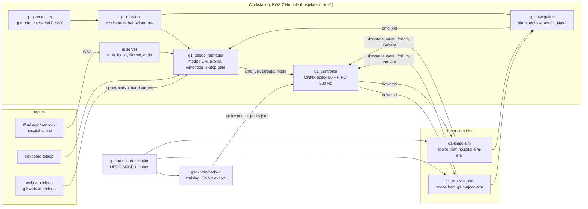

# hospital-sim: a humanoid robot in a simulated hospital

This repository is the master repository of hospital-sim, a Unitree G1 humanoid robot in a simulated
hospital with a surgical wing. The following parts drive the robot:

- a whole-body controller
- a mode manager with safety gates
- keyboard teleoperation or webcam teleoperation
- SLAM and Nav2 navigation
- a scripted scrub-nurse mission
- an operator UI for an iPad

Two simulators stand in for the robot. MuJoCo gives fast physics. Isaac Sim gives rendering, lidar
and cameras.

This repository holds no robot code of its own. It holds the interface contract, the shared
environment script and the list of component repositories. It checks the component repositories out
side by side, in the layout that the code expects. Clone this repository to get the whole stack.

Each component is its own GitHub repository. Because of this, a different robot can reuse the
hospital, the ROS 2 packages and the operator UI. The new robot brings its own description, simulator
bindings and controller. Repositories with the prefix `hospital-sim-` are robot agnostic. Repositories
with the prefix `g1-` are specific to the G1 29-DoF rev 1.0 with BrainCo Revo2 hands.

The table below lists the component repositories and the folder of each one.

| Folder | Repository | What it holds |
|---|---|---|
| `hospital-sim-env/` | [hospital-sim-env](hospital-sim-env/README.md) | Isaac Sim hospital and surgical wing, the layout generator that is the single source of room geometry, and the surgical instruments with their placements |
| `g1-brainco-description/` | [g1-brainco-description](g1-brainco-description/README.md) | Canonical G1 + BrainCo model: URDF, MJCF, meshes, robot_spec.json, build and check scripts |
| `g1-mujoco-sim/` | [g1-mujoco-sim](g1-mujoco-sim/README.md) | MuJoCo version of the hospital, generated from the same layout, with the G1 placed in it |
| `g1-isaac-sim/` | [g1-isaac-sim](g1-isaac-sim/README.md) | G1 in the Isaac hospital: physics layer, lidar, cameras, DDS and ROS 2 bridge |
| `g1-whole-body-rl/` | [g1-whole-body-rl](g1-whole-body-rl/README.md) | Whole-body controller training in MuJoCo/MJX and the ONNX export the controller node loads |
| `ros2_ws/src/hospital-sim-ros2/` | [hospital-sim-ros2](ros2_ws/src/hospital-sim-ros2/README.md) | ROS 2 Humble packages: interfaces, controller, mode manager, keyboard teleop, MuJoCo sim node, navigation, mission, perception node, bringup |
| `g1-webcam-teleop/` | [g1-webcam-teleop](g1-webcam-teleop/README.md) | Seated webcam teleoperation (OBSBOT Tiny 3) through a fork of xr_teleoperate |
| `hospital-sim-ui/` | [hospital-sim-ui](hospital-sim-ui/README.md) | Operator UI: iPad PWA, engineering console and the aiohttp + rclpy server behind them |
| `docs/` | this repo | [interfaces.md](docs/interfaces.md) is the binding contract between the parts. [architecture.md](docs/architecture.md) has the full system map |
| `datasets/` | Hugging Face | Recorded data. Not in git, see [datasets/README.md](datasets/README.md) |

The folder `ros2_ws/` is the colcon workspace. Only its folder `src/hospital-sim-ros2` is a
repository. The build produces the folders `build/`, `install/` and `log/`.

An instrument detector for the mission is developed in a separate private repository. Nothing here
depends on it. The perception node runs in ground-truth mode in simulation. You can supply any
detector that follows the ONNX contract of the node through a parameter.

## How the system works

Every part speaks the low-level interface of the real robot. The controller publishes motor targets
on `/lowcmd` at 500 Hz and reads the joint state on `/lowstate`, exactly as on the hardware. In
simulation, the MuJoCo node or the Isaac bridge consumes `/lowcmd` and produces `/lowstate`. The same
node also produces the sensors of a real G1: the lidar scan, the odometry and the head camera.
Because of this, every layer above the controller is identical in MuJoCo, in Isaac and, later, on the
robot.

The mode manager sits above the controller. It owns a state machine with the modes DAMP, STAND, LOCO,
MANIP, NAV, AUTO and HOLD. It is the only node that sends commands to the controller. Every input
source publishes requests to the mode manager, and the mode manager arbitrates between them. The
input sources are the keyboard, the webcam teleoperation, the operator UI, Nav2 and the mission. The
mode manager applies four rules:

- A control lease decides which input source is in charge.
- A watchdog drops to HOLD when the heartbeat of the UI stops.
- A hardware e-stop gate overrides everything.
- Speed zones from the map cap the velocity.

HOLD stops the robot in place. DAMP powers the robot off.

The controller runs a whole-body policy at 50 Hz. The policy is an ONNX export. The controller
converts the output of the policy into PD targets. The RL repository trains the policy in MuJoCo/MJX
in three stages:

1. Stand.
2. Walk with upper-body targets.
3. Track full motion.

No policy is trained yet, so the controller uses a placeholder legs-only policy.

Navigation uses standard ROS 2 packages. The package slam_toolbox builds the map. The packages
map_server and AMCL localise the robot. Nav2, with its MPPI controller plugin, plans the path and
drives the robot. In NAV mode, the mode manager converts the velocity command of Nav2 into controller
input.

The mission layer is a py_trees behaviour tree that plays the scrub nurse. The mission has five steps:

1. Go to the instrument table.
2. Locate an instrument.
3. Pick the instrument.
4. Carry the instrument to the surgeon.
5. Hand the instrument over.

The mission uses navigation for the walking part. It publishes upper-body targets and hand targets
for the arm part.

The operator UI is one process that combines an aiohttp web server with an rclpy node. It serves an
iPad web app for clinical staff and an engineering console for developers. Both run over a WebSocket
protocol with roles, a 3 s undo window, alarms and an audit log. The operator UI also runs SLAM and
Nav2, and it manages maps and goals.

A Python layout file defines the hospital once. From this file, the environment repository generates
the Isaac USD layers. The MuJoCo repository generates matching walls and furniture boxes in the same
world frame. Because of this, a map built in one simulator is valid in the other.

## Architecture



The full node catalogue with every topic is in [docs/architecture.md](docs/architecture.md). The
topic names, the joint order, the modes, the key bindings and the policy sidecar format are in
[docs/interfaces.md](docs/interfaces.md).

## Dependencies

The table below lists the system software. Install it once on the workstation.

| Dependency | Version used | Needed by |
|---|---|---|
| Ubuntu | 22.04 | everything |
| ROS 2 Humble with Nav2, slam_toolbox, robot_state_publisher, rviz2, rmw_cyclonedds_cpp | apt packages | hospital-sim-ros2, hospital-sim-ui, g1-webcam-teleop |
| Python | 3.10 (system) | the shared `.venv` |
| colcon | any recent | building `ros2_ws` |
| vcstool | 0.3.0 | checking out the component repos |
| uv | 0.12.19 | USD scripts (`usd-core`) and the object generator |
| conda (miniconda) | any recent | the `g1-mjx` and `ultra-sim2sim` environments of g1-whole-body-rl |
| NVIDIA driver and CUDA-capable GPU | RTX 3070 8 GB used here | Isaac Sim, JAX training, lidar ray casting |
| Isaac Sim | 6.0.0 | hospital-sim-env scene work and g1-isaac-sim |
| ffmpeg | any | rendering videos from recordings |

Each component README lists its own Python packages with exact versions and ships a
`requirements.txt`. The following assets and data are not in any repository:

- the NVIDIA Isaac Sim asset pack and the Isaac for Healthcare asset catalog (see hospital-sim-env)
- the recorded datasets on Hugging Face (see `datasets/README.md`)
- trained policies, of which there are none yet

## Install

1. Clone the master repository and check out the component repositories.

```bash
git clone https://github.com/Bkrakshith/hospital-sim.git Hospital_G1
cd Hospital_G1
git submodule update --init          # the component repos, pinned to tested commits
# or, to track each component's main branch instead:
pip install vcstool && vcs import < hospital-sim.repos
```

2. Create the shared Python environment and install the requirements of each component.

```bash
python3 -m venv --system-site-packages .venv      # system site-packages so rclpy is visible
source env.sh
for r in g1-brainco-description g1-mujoco-sim ros2_ws/src/hospital-sim-ros2 hospital-sim-ui g1-webcam-teleop hospital-sim-env; do
  [ -f "$r/requirements.txt" ] && .venv/bin/pip install -r "$r/requirements.txt"
done
```

The teleop repository needs pinocchio from pre-built wheels. The RL repository needs its conda
environment. Both procedures are in their READMEs.

3. Build the ROS 2 packages.

```bash
source env.sh && (cd ros2_ws && colcon build --symlink-install) && source env.sh
```

## Environments

The script `env.sh` prepares the shell. It strips the conda libraries from `LD_LIBRARY_PATH`, because
they break rclpy. It sources ROS 2 Humble and activates the shared `.venv`. It sources the `ros2_ws`
overlay after the build has produced it. It also exports `HG1_ROOT`, which the launch files and the
scripts use to find sibling components.

The table below lists the Python environments and their users.

| Environment | Used by | Notes |
|---|---|---|
| `.venv/` | ROS 2 nodes, UI server, teleop, objects, robot checks, MuJoCo | system python 3.10 with system site-packages. Install with `.venv/bin/pip` |
| conda `g1-mjx` | g1-whole-body-rl | JAX / MJX, mujoco 3.10. Keep it out of `.venv` |
| conda `ultra-sim2sim` | g1-whole-body-rl/ultra_eval | the released ULTRA teacher |
| `~/isaacsim` python | g1-isaac-sim, hospital-sim-env/isaac | Isaac Sim 6.0, python 3.12 |

## Run

Each command below runs one part of the stack. The comment above each command says what it runs.

```bash
source env.sh

# MuJoCo hospital with the G1, controller and mode manager
ros2 launch g1_bringup sim.launch.py

# the same stack on Isaac Sim (start the simulator first, in another terminal)
./g1-isaac-sim/run.sh --headless
ros2 launch g1_bringup sim.launch.py backend:=isaac

# SLAM and navigation on top of a running sim
ros2 launch g1_bringup slam.launch.py use_sim_time:=true
ros2 launch g1_bringup nav.launch.py

# the scripted scrub-nurse mission (fixed base, theatre objects)
ros2 launch g1_bringup mission.launch.py

# operator UI and engineering console
ros2 launch g1_bringup dashboard.launch.py        # https://localhost:8443 and /console

# open the hospital scene in the Isaac Sim editor
./hospital-sim-env/isaac/launch_isaac.sh --open
```

Each component README has its own build, test and run instructions.

## Test / check

The commands below check the installation. The comment beside each command gives the expected
result.

```bash
source env.sh
.venv/bin/python g1-brainco-description/check_model.py          # 27 PASS, 2 WARN, 0 FAIL
.venv/bin/python g1-mujoco-sim/build_world.py --check            # scenes compile
(cd ros2_ws && colcon test && colcon test-result --verbose | tail -3)
.venv/bin/python -m pytest hospital-sim-ui/server/tests -q       # 68 passed
```

## Working across repositories

The contract in `docs/interfaces.md` lets the repositories change independently. Read the contract
before you change a topic, a joint order, a config path or a folder name. Update the contract in the
same change. Components find each other through `HG1_ROOT` or relative to their own location, never
through absolute paths. Because of this, the checkout can live in any folder. When a component
changes in a way that the others must follow, update its submodule pin here in the same pull request.

Machine notes for the development workstation are at the end of `docs/interfaces.md`.

## Status

The stack runs end to end in both simulators with a placeholder locomotion policy. The whole-body
policy is not trained yet. The instrument detector is not part of this assembly. Nothing has run on a
physical robot.

## License

The license of this repository is the Apache License, Version 2.0 (see `LICENSE`).
You can use, change and share this work, also for commercial use.
If you share this work or a work that you built on it, keep the `NOTICE` file.
Give this credit in your documentation and product credits: "Based on hospital-sim by Bkrakshith (https://github.com/Bkrakshith/hospital-sim)".
To cite this work in a publication, use `CITATION.cff`.
