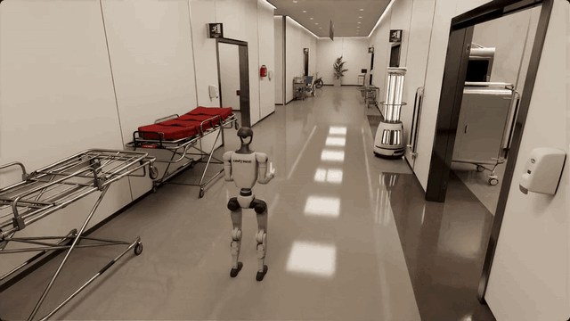
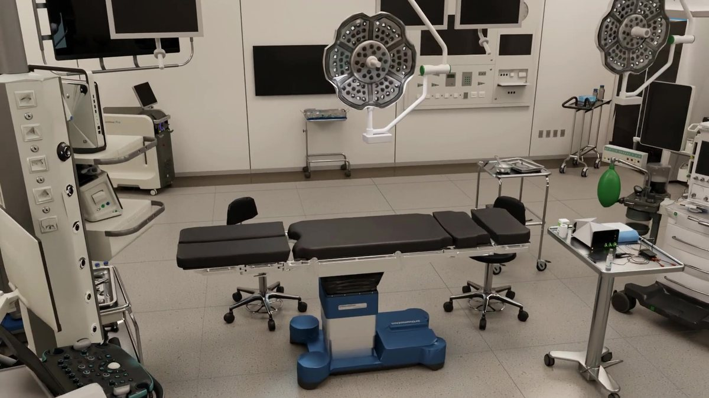
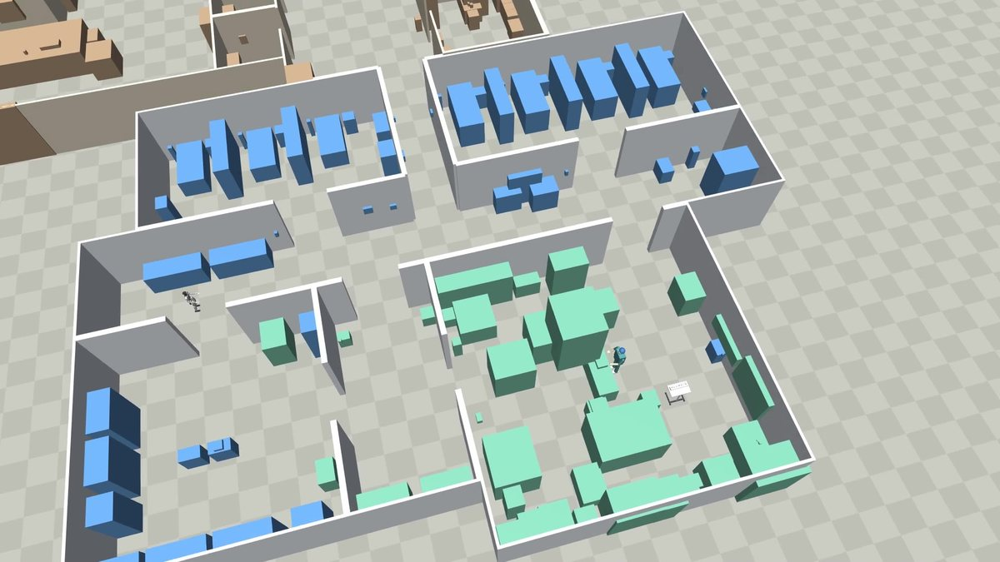
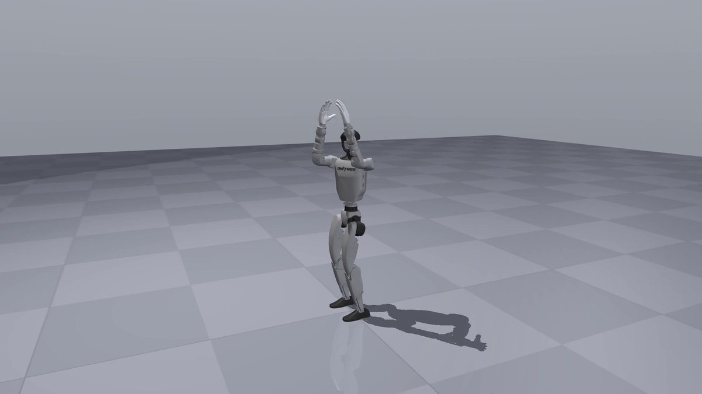
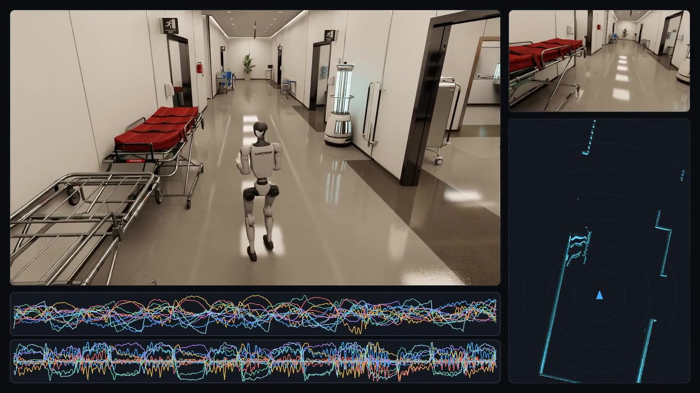
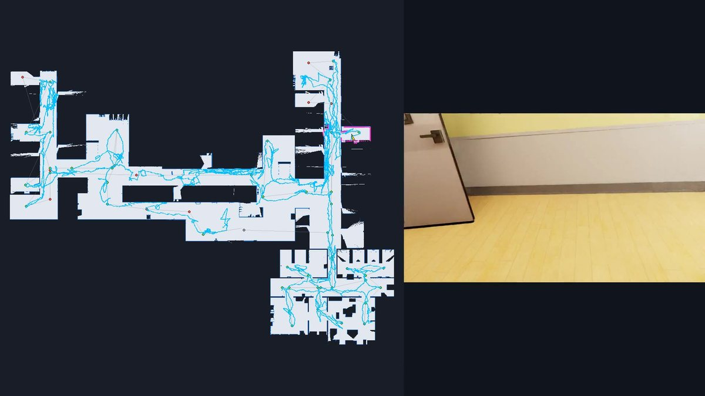
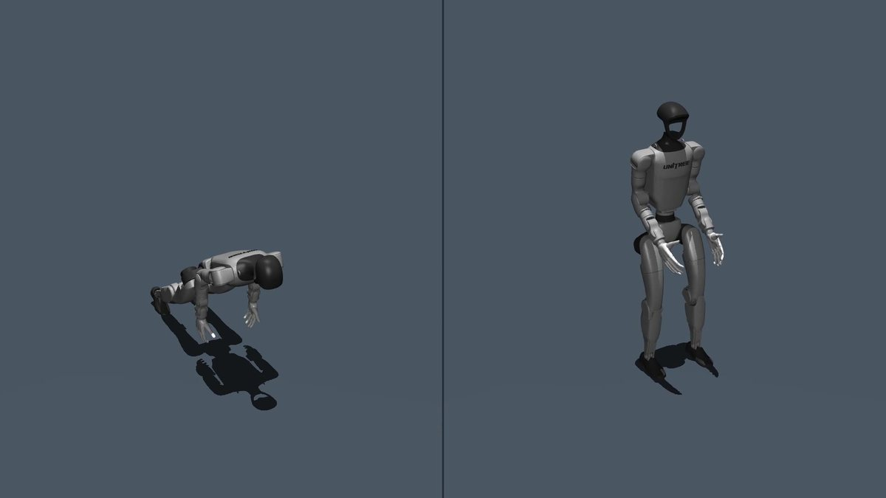
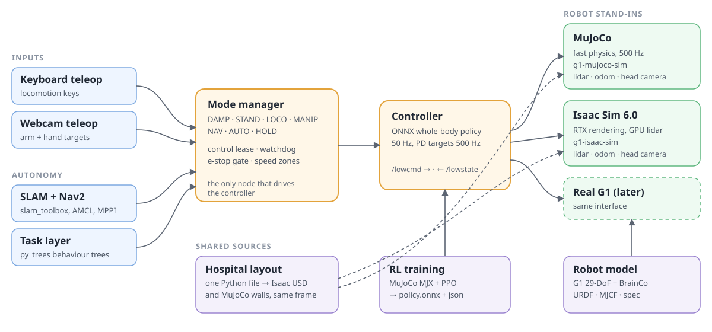

# WardZero: the simulated hospital where robots train before they meet patients

<p align="center">
  
</p>

<p align="center">
  <a href="LICENSE"></a>
  
  
  
  
</p>

<p align="center">
  <a href="https://bkrakshith.github.io/wardzero/">Project page and video clips</a> ·
  <a href="#install-wardzero-on-your-computer">Install</a> ·
  <a href="#computer-requirements">Computer requirements</a> ·
  <a href="#how-wardzero-works">How it works</a>
</p>

WardZero is an open-source simulated hospital for robots. You can download it, run it on your own
computer and use it to build and test your own robot systems. A robot can walk, make maps and navigate
in the hospital before it goes near a real patient.

The hospital has a ground floor and a surgical wing with corridors, pre-operative bays, a sterile store,
a scrub room and an operating theatre. The reference robot is a Unitree G1 humanoid with two BrainCo
Revo2 hands. The platform does not depend on this robot. You can add your own robot and keep the
hospital, the ROS 2 packages and the tools.

Built by Rakshith Bangalore Kumaraswamy.

> **Note:** WardZero is a simulation. Nothing in this repository has run on a physical robot or in a
> real hospital.

## Quick start (MuJoCo only, no GPU)

The MuJoCo workload runs on a laptop without an NVIDIA GPU. On Ubuntu 22.04 with
[ROS 2 Humble](https://docs.ros.org/en/humble/Installation/Ubuntu-Install-Debs.html) installed:

```bash
sudo apt install ros-humble-navigation2 ros-humble-nav2-bringup ros-humble-slam-toolbox \
  ros-humble-rmw-cyclonedds-cpp python3-colcon-common-extensions python3-vcstool python3-venv git
git clone --recurse-submodules https://github.com/Bkrakshith/hospital-sim.git WardZero && cd WardZero
python3 -m venv --system-site-packages .venv && source env.sh
for r in g1-brainco-description g1-mujoco-sim ros2_ws/src/hospital-sim-ros2 g1-webcam-teleop hospital-sim-env; do
  [ -f "$r/requirements.txt" ] && .venv/bin/pip install -r "$r/requirements.txt"
done
(cd ros2_ws && colcon build --symlink-install) && source env.sh
ros2 launch g1_bringup sim.launch.py viewer:=true     # the G1 in the MuJoCo hospital
```

Then in a second terminal: `source env.sh && ros2 run g1_teleop_keyboard keyboard_node` and press `r`
to stand, `l` to switch to walking, then `w` to walk forward. Isaac Sim and controller training are optional and need a GPU; see
[Install](#install-wardzero-on-your-computer).

**Have a different robot?** Keep the hospital and the ROS 2 stack and swap the `g1-*` repositories.
See [Add your own robot](#add-your-own-robot).

## What you can do with WardZero

Use WardZero to do these tasks on your own computer:

- Run a humanoid robot in the hospital in two simulators: MuJoCo for fast physics and Isaac Sim for realistic sensors.
- Drive the robot with the keyboard or with your arms and hands in front of a webcam.
- Make a map of the hospital with slam_toolbox and navigate with Nav2.
- Train a whole-body controller with reinforcement learning in MuJoCo MJX.
- Add your own robot model, simulator bindings and controller, and use the same hospital.

The table below shows the main parts of WardZero.

| | |
|---|---|
| <br>**Hospital and surgical wing.** One Python layout file makes the Isaac Sim scene. | <br>**MuJoCo hospital world.** A generator makes this world from the same layout file, in the same world frame. |
| <br>**Reference robot.** A Unitree G1 29-DoF with two 6-DoF BrainCo Revo2 hands, as URDF and MJCF. | <br>**Isaac Sim backend.** The same robot interface as the real robot, with lidar and a head camera. |
| <br>**Mapping and navigation.** slam_toolbox makes the map while Nav2 drives the robot on a route. | <br>**Controller training.** PPO in MuJoCo MJX trains the robot to stand. |

More clips are on the [project page](https://bkrakshith.github.io/wardzero/).

## Computer requirements

WardZero has three workloads. Each workload needs a different computer. The MuJoCo workload runs
without Isaac Sim and without an NVIDIA GPU, so you can start with a small computer.

The table below gives the workloads.

| Workload | What it runs | NVIDIA GPU |
|---|---|---|
| MuJoCo simulation | The hospital in MuJoCo, the controller, the mode manager, teleoperation, SLAM and navigation | Not necessary |
| Isaac Sim simulation | The same ROS 2 stack on the Isaac Sim hospital with realistic lidar and camera | Necessary |
| Controller training | Reinforcement learning in MuJoCo MJX | Necessary |

The table below gives the minimum computer and the desired computer.

| Item | Minimum | Desired |
|---|---|---|
| Operating system | Ubuntu 22.04 LTS, x86_64 | Ubuntu 22.04 LTS, x86_64 |
| CPU | 4 cores (Intel Core i7 7th generation or AMD Ryzen 5) | 8 to 16 cores (Intel Core i9 or AMD Ryzen 9) |
| RAM | 16 GB for MuJoCo only. 32 GB with Isaac Sim. | 64 GB |
| GPU | None for MuJoCo only. NVIDIA RTX with 8 GB of VRAM for Isaac Sim and for training. | NVIDIA RTX with 16 GB of VRAM or more (GeForce RTX 4080 or better) |
| NVIDIA driver | The version that NVIDIA specifies for your Isaac Sim release | 595.58 or later (NVIDIA requirement for Isaac Sim 6.0) |
| Storage | 20 GB of SSD for MuJoCo only. 200 GB of SSD with Isaac Sim and its asset packs. | 500 GB of NVMe SSD |
| Camera (optional) | Any USB webcam that supports UVC, for webcam teleoperation | OBSBOT Tiny 3, which adds automatic pan, tilt and zoom |

Read these notes before you select a computer:

- NVIDIA gives the official Isaac Sim requirements in the [Isaac Sim documentation](https://docs.isaacsim.omniverse.nvidia.com/latest/installation/requirements.html). NVIDIA specifies 16 GB of VRAM as the minimum for Isaac Sim 6.0.
- WardZero also runs on an 8 GB GPU with the reduced asset set. The full hospital scene then uses about 7 GB of VRAM. Use the command `select_assets.py lite` (see [hospital-sim-env](hospital-sim-env/README.md)).
- On a GPU with 8 GB of VRAM, the first training stage (stand) took about 1 hour with 2048 robots in parallel.
- The minimum values for the MuJoCo workload are estimates. The values for Isaac Sim come from NVIDIA.
- Isaac Sim needs about 35 GB of storage. The NVIDIA asset packs need about 100 GB more.

## Install WardZero on your computer

Do these steps on a computer with Ubuntu 22.04. The steps install the MuJoCo workload first. The Isaac
Sim and training steps are optional.

1. Install ROS 2 Humble. Follow the [ROS 2 Humble installation guide](https://docs.ros.org/en/humble/Installation/Ubuntu-Install-Debs.html). Then install the packages that WardZero uses.

```bash
sudo apt install ros-humble-desktop ros-humble-navigation2 ros-humble-nav2-bringup \
  ros-humble-slam-toolbox ros-humble-rmw-cyclonedds-cpp \
  python3-colcon-common-extensions python3-vcstool python3-venv git
```

2. Clone this repository and all the component repositories.

```bash
git clone --recurse-submodules https://github.com/Bkrakshith/hospital-sim.git WardZero
cd WardZero
```

3. Make the shared Python environment and install the Python packages.

```bash
python3 -m venv --system-site-packages .venv      # system site-packages make rclpy visible
source env.sh
for r in g1-brainco-description g1-mujoco-sim ros2_ws/src/hospital-sim-ros2 g1-webcam-teleop hospital-sim-env; do
  [ -f "$r/requirements.txt" ] && .venv/bin/pip install -r "$r/requirements.txt"
done
```

4. Build the ROS 2 packages.

```bash
source env.sh && (cd ros2_ws && colcon build --symlink-install) && source env.sh
```

5. Run the robot in the MuJoCo hospital.

```bash
ros2 launch g1_bringup sim.launch.py
```

6. Optional: install Isaac Sim 6.0 and the NVIDIA asset packs. Then connect the assets to the hospital
   scene. The [hospital-sim-env README](hospital-sim-env/README.md) gives the procedure.

7. Optional: make the conda environment for controller training. The
   [g1-whole-body-rl README](g1-whole-body-rl/README.md) gives the procedure.

8. Optional: install the pinocchio wheels for webcam teleoperation. The
   [g1-webcam-teleop README](g1-webcam-teleop/README.md) gives the procedure.

To follow the main branch of each component instead of the tested versions, use vcstool:

```bash
vcs import < hospital-sim.repos
```

## Run

Run `source env.sh` in each new terminal first. Each command below runs one part of WardZero.

```bash
# The robot in the MuJoCo hospital, with the controller and the mode manager
ros2 launch g1_bringup sim.launch.py

# The same stack on Isaac Sim (run the simulator first, in a different terminal)
./g1-isaac-sim/run.sh --headless
ros2 launch g1_bringup sim.launch.py backend:=isaac

# Mapping and navigation, on a simulator that runs
ros2 launch g1_bringup slam.launch.py use_sim_time:=true
ros2 launch g1_bringup nav.launch.py

# The hospital scene in the Isaac Sim editor
./hospital-sim-env/isaac/launch_isaac.sh --open
```

Each component README gives more commands and options.

## Test the installation

Run these commands to test the installation. The comment beside each command gives the expected result.

```bash
source env.sh
.venv/bin/python g1-brainco-description/check_model.py          # 27 PASS, 2 WARN, 0 FAIL
.venv/bin/python g1-mujoco-sim/build_world.py --check            # the scenes compile
(cd ros2_ws && colcon test && colcon test-result --verbose | tail -3)
```

## How WardZero works

The diagram shows the parts of WardZero and the data between them.

<p align="center">
  
</p>

The controller uses the interface of the real robot. It sends motor targets on `/lowcmd` at 500 Hz and
reads the joint state on `/lowstate`. In simulation, the MuJoCo node or the Isaac Sim bridge receives
`/lowcmd` and sends `/lowstate`. The simulators also send the sensor data of a real G1: the lidar scan,
the odometry and the head camera. Thus every layer above the controller is the same in MuJoCo, in Isaac
Sim and on a real robot.

The mode manager is above the controller. It has a state machine with the modes DAMP, STAND, LOCO,
MANIP, NAV, AUTO and HOLD. The mode manager is the only node that sends commands to the controller. The
keyboard, the webcam teleoperation, Nav2 and the task layer send requests to the mode manager. The mode
manager then applies these safety rules:

- A control lease sets which input is in control.
- A watchdog changes the mode to HOLD when a heartbeat stops.
- A hardware e-stop gate stops all inputs.
- Speed zones from the map limit the velocity.

In HOLD, the robot stops in its position. In DAMP, the motors are off.

The controller runs a whole-body policy at 50 Hz and changes its output into PD targets. The policy
comes from the training repository, which trains it in MuJoCo MJX in stages. The first stage teaches the
robot to stand. The later stages teach walking and motion tracking. Until these stages are complete, the
ROS 2 stack uses a placeholder policy for the legs.

Navigation uses standard ROS 2 packages. slam_toolbox makes the map. The map server and AMCL find the
position of the robot. Nav2 with the MPPI controller plans the path and drives the robot. The task layer
uses py_trees behaviour trees.

One Python layout file defines the hospital. The environment repository makes the Isaac Sim scene from
this file. The MuJoCo repository makes walls and furniture boxes from the same file, in the same world
frame. Thus a map that you make in one simulator is correct in the other simulator.

The topic names, the joint order, the modes, the key bindings and the policy format are in
[docs/interfaces.md](docs/interfaces.md).

## Repositories

WardZero has one master repository and one repository for each component. The master repository is this
repository. It holds no robot code. It holds the shared environment script, the interface contract and
the versions of the component repositories. Repositories with the prefix `hospital-sim-` do not depend on
a robot. Repositories with the prefix `g1-` are specific to the G1 robot.

The table below lists the repositories.

| Folder | Repository | Contents |
|---|---|---|
| `hospital-sim-env/` | [hospital-sim-env](https://github.com/Bkrakshith/hospital-sim-env) | The Isaac Sim hospital and surgical wing, the layout generator, and the surgical objects |
| `g1-brainco-description/` | [g1-brainco-description](https://github.com/Bkrakshith/g1-brainco-description) | The G1 with BrainCo hands: URDF, MJCF, meshes, robot specification, build and check scripts |
| `g1-mujoco-sim/` | [g1-mujoco-sim](https://github.com/Bkrakshith/g1-mujoco-sim) | The MuJoCo hospital world with the G1 in it |
| `g1-isaac-sim/` | [g1-isaac-sim](https://github.com/Bkrakshith/g1-isaac-sim) | The G1 in the Isaac Sim hospital: physics, lidar, cameras, DDS and ROS 2 bridge |
| `g1-whole-body-rl/` | [g1-whole-body-rl](https://github.com/Bkrakshith/g1-whole-body-rl) | Whole-body controller training in MuJoCo MJX and the ONNX export |
| `ros2_ws/src/hospital-sim-ros2/` | [hospital-sim-ros2](https://github.com/Bkrakshith/hospital-sim-ros2) | The ROS 2 Humble packages: interfaces, controller, mode manager, teleoperation, simulator node, navigation, task layer, bringup |
| `g1-webcam-teleop/` | [g1-webcam-teleop](https://github.com/Bkrakshith/g1-webcam-teleop) | Webcam teleoperation of the arms and hands |
| `docs/` | this repository | The interface contract and the system architecture |
| `datasets/` | Hugging Face | Recorded data. It is not in git. See [datasets/README.md](datasets/README.md). |

The folder `ros2_ws/` is the colcon workspace. The build makes the folders `build/`, `install/` and `log/` in it.

## Dependencies

The table below lists the system software and the components that use it.

| Dependency | Version | Used by |
|---|---|---|
| Ubuntu | 22.04 | all components |
| ROS 2 Humble with Nav2, slam_toolbox, robot_state_publisher, rviz2, rmw_cyclonedds_cpp | apt packages | hospital-sim-ros2, g1-webcam-teleop |
| Python | 3.10 (system) | the shared `.venv` |
| colcon | any recent version | the build of `ros2_ws` |
| vcstool | 0.3.0 or later | the checkout of the component repositories |
| uv | 0.12 or later | the USD scripts (`usd-core`) and the object generator |
| conda (Miniconda) | any recent version | the training environments of g1-whole-body-rl |
| Isaac Sim | 6.0 | hospital-sim-env scene work and g1-isaac-sim |
| ffmpeg | any version | videos from recordings |

Each component README lists its Python packages with versions. Each component also has a
`requirements.txt`. These items are not in any repository:

- the NVIDIA Isaac Sim asset pack and the Isaac for Healthcare asset catalog (see hospital-sim-env)
- the recorded datasets (see `datasets/README.md`)

## Python environments

The script `env.sh` prepares the shell. It removes the conda libraries from `LD_LIBRARY_PATH`, because
they stop rclpy. It sources ROS 2 Humble and activates the shared `.venv`. After the build, it also
sources the `ros2_ws` overlay. It sets `HG1_ROOT`, which the launch files and the scripts use to find
the other components.

The table below lists the Python environments.

| Environment | Used by | Notes |
|---|---|---|
| `.venv/` | ROS 2 nodes, teleoperation, objects, robot checks, MuJoCo | System Python 3.10 with system site-packages. Install packages with `.venv/bin/pip`. |
| conda `g1-mjx` | g1-whole-body-rl | JAX and MJX, MuJoCo 3.10. Do not install these packages into `.venv`. |
| conda `ultra-sim2sim` | g1-whole-body-rl/ultra_eval | The released ULTRA teacher policy, for comparison |
| Isaac Sim Python | g1-isaac-sim, hospital-sim-env/isaac | Isaac Sim 6.0, Python 3.12 |

## Add your own robot

Keep the repositories with the prefix `hospital-sim-`. Replace the repositories with the prefix `g1-`
with repositories for your robot:

1. Make a description repository with the URDF and MJCF of your robot.
2. Connect your robot to the MuJoCo world and to the Isaac Sim scene.
3. Train or supply a controller that reads `/lowstate` and writes `/lowcmd`.
4. Read [docs/interfaces.md](docs/interfaces.md) and keep the same topics, so that the ROS 2 stack works without change.

When you change a topic, a joint order, a configuration path or a folder name, also change the
interface contract. Components find each other through `HG1_ROOT` or relative to their own folder.
They do not use absolute paths, so you can put the checkout in any folder.

## Status

These parts work in both simulators:

- the robot interface, the mode manager and the teleoperation
- mapping and navigation through the hospital and the surgical wing
- the first training stage of the controller (stand)

The walking and motion-tracking stages of the controller are not trained yet. The ROS 2 stack walks
with a placeholder policy for the legs. Nothing has run on a physical robot.

## License

The license of this repository is the Apache License, Version 2.0 (see `LICENSE`).
You can use, change and share this work, also for commercial use.
If you share this work or a work that you built on it, keep the `NOTICE` file.
Give this credit in your documentation and product credits: "Based on hospital-sim by Bkrakshith (https://github.com/Bkrakshith/hospital-sim)".
To cite this work in a publication, use `CITATION.cff`.
