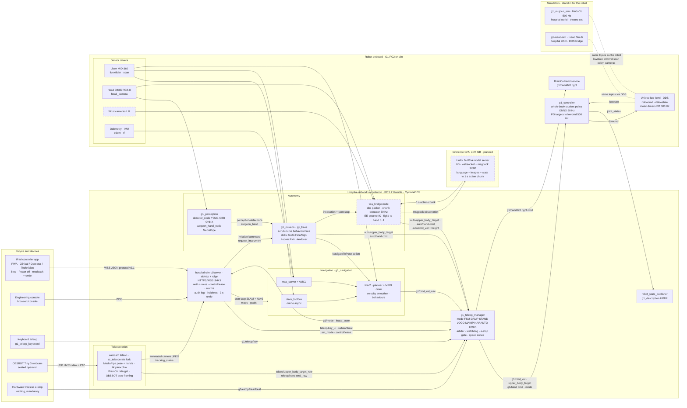
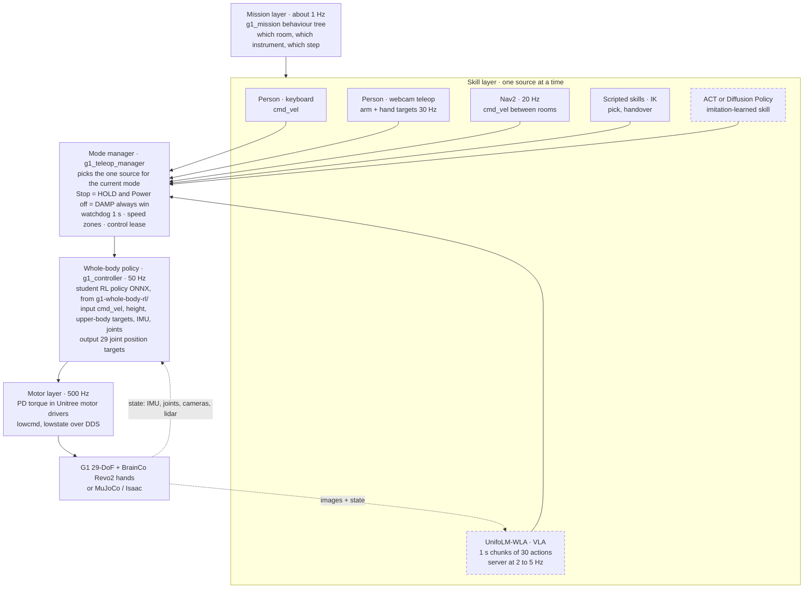
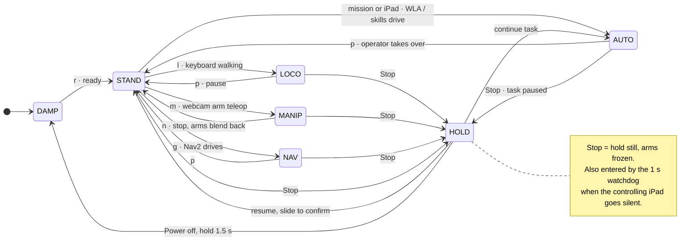
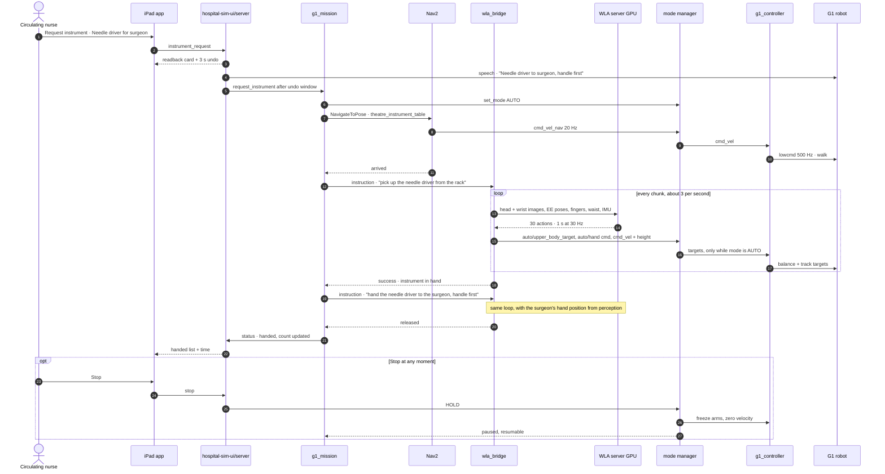
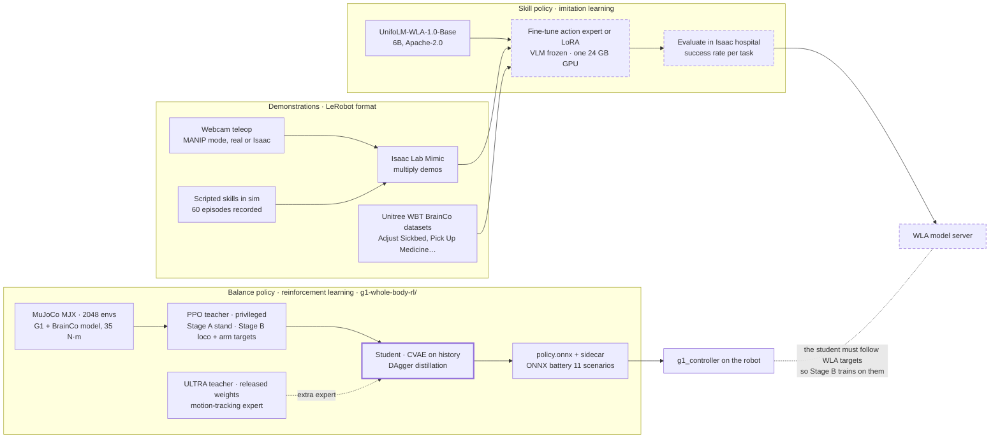

# Hospital_G1 system architecture

Mermaid source for the architecture diagrams. The same diagrams, with the UnifoLM-WLA assessment and the node
catalogue, are published as the "Hospital G1 Architecture" page. Dashed boxes are planned, not built.

## UnifoLM-WLA in one paragraph

Unitree's 6B vision-language-action model (UnifoLM-ER-1 4B reasoning backbone + MMDiT action expert, Apache-2.0,
github.com/unitreerobotics/unifolm-wla). Inputs: head + wrist cameras, robot state, a sentence. Output: 1 s chunks of
30 actions at 30 Hz in a 54-value space (both end-effector poses, 6 BrainCo finger values per hand, waist, base
vx/vy/yaw rate, height, legs). Trained partly on a G1 with BrainCo hands (`unitree_g1_brainco`; datasets include
Adjust Sickbed, Pick Up Medicine, Make Bed). Fits our stack as the skill layer, driving only in AUTO through a
`wla_bridge` node. Needs a >= 24 GB GPU (12.5 GB weights), wrist cameras, an extended model server (the released one
only speaks the two-finger-gripper action space), our trained student policy with a height input, and a fine-tune on
hospital demonstrations.

## System map: every node, server and device

## Control layers: who decides what, and how fast

## Modes: only one thing drives at a time

## One instrument request, end to end, with UnifoLM-WLA as the skill

## Data and training: how the policies get made

